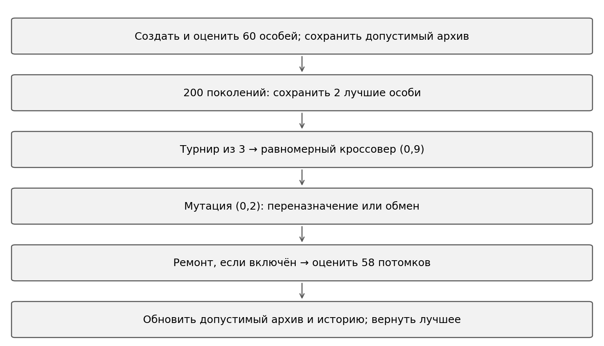
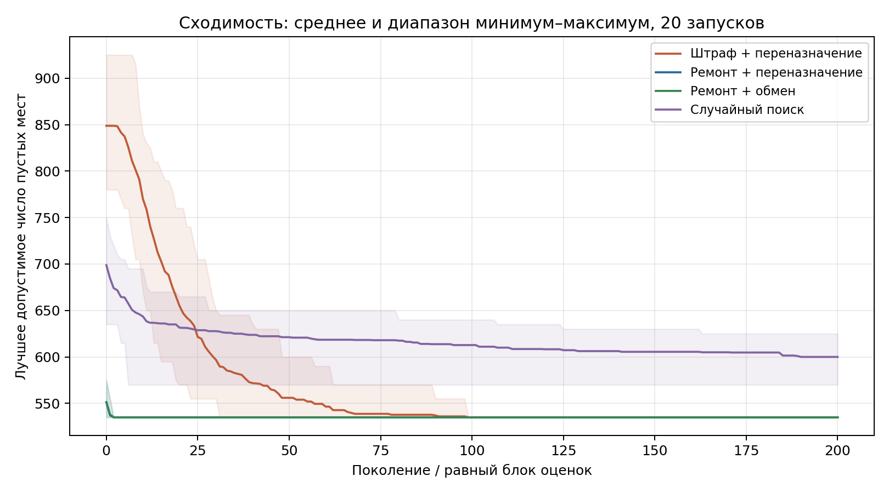
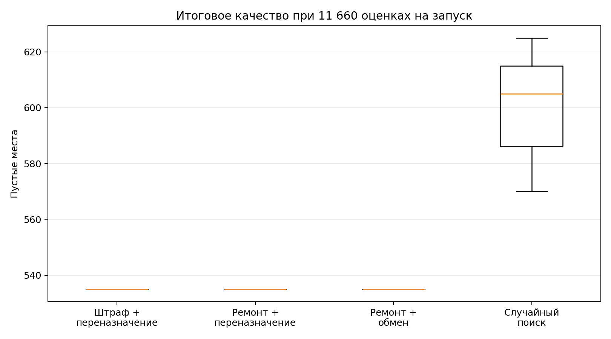
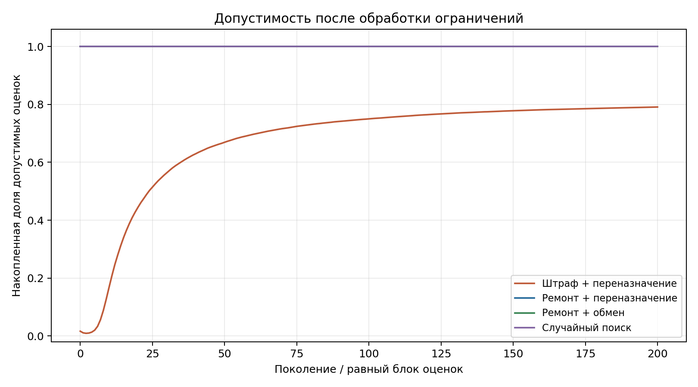

# Лабораторная работа № 2

## Генетический алгоритм для назначения аудиторий

Дисциплина «Эволюционное программирование и генетические алгоритмы». Вариант 9.
Программа написана на Python 3. Генетический алгоритм, операторы и поиск
паросочетания реализованы самостоятельно. NumPy используется для случайных
чисел, Matplotlib — для графиков, ReportLab — для PDF.

## 1. Задача

Нужно назначить аудитории 30 занятиям. В каждом из шести непересекающихся
временных интервалов проходят пять занятий. Доступны шесть аудиторий на
25, 35, 45, 60, 80 и 100 человек. Время фиксировано; переносить занятия нельзя.

Аудитория должна вмещать всю группу. В один интервал аудиторию можно назначить
только одному занятию. В разных интервалах её можно использовать повторно.
Каждое занятие относится к отдельной группе; преподаватели, оснащение,
переходы между корпусами и предпочтения по времени в модель не входят.

Пространство решений — все списки из 30 целых чисел от 0 до 5; xᵢ — индекс
аудитории занятия i. В таблицах аудитории имеют номера от 1 до 6. Обозначим число студентов
через sᵢ, вместимость комнаты через cᵣ, интервал занятия через tᵢ.

Для допустимого расписания минимизируем сумму пустых мест F(x) = Σᵢ (c[xᵢ] − sᵢ).

Для каждого занятия требуется c[xᵢ] ≥ sᵢ, а для каждой пары одновременных
занятий (tᵢ = tⱼ) требуется xᵢ ≠ xⱼ. В каждом интервале 5 × 4 / 2 = 10 таких пар,
поэтому всего 60 попарных ограничений конфликтности.
Пустые места суммируются по занятиям, поэтому комната учитывается заново
в каждом интервале. Минимизация пустых мест уточняет постановку варианта.

Входные данные синтетические, seed 900. Для каждого интервала сначала выбираются
пять различных аудиторий, затем размер каждой группы равномерно выбирается
из целых чисел от 15 до вместимости выбранной аудитории включительно.
Это гарантирует существование допустимого решения. Исходное назначение
при генерации не сохраняется и не передаётся алгоритмам. Все данные приложены
в data/instance.json, процедура генерации — в src/problem.py.

## 2. Представление решения и алгоритм

Одна особь — список из 30 номеров аудиторий. Генотип прямо задаёт назначение;
фенотип — расписание с временем, числом студентов и вместимостью. Декодирование
заменяет индексы комнат их номерами и добавляет сведения из входных данных.
Дискретный ген не изменяет время занятия и не требует округления.



Общие параметры трёх конфигураций:

| Параметр | Значение |
| --- | --- |
| Размер популяции | 60 |
| Число поколений | 200 |
| Элита | 2 |
| Размер турнира | 3 |
| Вероятность кроссовера | 0,9 |
| Вероятность мутации потомка | 0,2 |
| Запуски и seed | 20; 1000–1019 |

Турнир выбирает три индекса с возвращением; побеждает меньший фитнес.
Равномерный кроссовер независимо выбирает каждое назначение от одного из
родителей с вероятностью 1/2. С вероятностью 0,9 создаётся такой потомок,
иначе берётся копия первого родителя. Затем возможна мутация.

Две лучшие особи переходят без повторной оценки. Остальные 58 мест занимают
потомки. Число оценок на запуск: 60 + 200 × 58 = 11 660.
Остановка — строго после 200 поколений, даже если улучшений больше нет.
Лучшее допустимое назначение хранится отдельно от текущей популяции.

## 3. Ограничения, операторы и примеры

В штрафном варианте H(x) — число занятий с недостаточной вместимостью плюс
число конфликтующих пар. Три занятия в одной комнате в одно время дают
три конфликтующие пары. Фитнес:

Q(x) = Σᵢ max(0, c[xᵢ] − sᵢ) + 3001 × H(x).

Для допустимого решения сумма не превышает 30 × 100 = 3000. Одно нарушение
даёт не менее 3001. Поэтому любое допустимое решение лучше любого
недопустимого. История качества использует F только допустимых решений,
а не штрафной фитнес. Начальная популяция включает одну случайную допустимую
особь и 59 случайных векторов назначений.

Ремонт строит полное паросочетание отдельно для каждого интервала. Ребро
связывает занятие с аудиторией достаточной вместимости. Сначала пробуется
назначение потомка, затем комнаты по возрастанию избытка вместимости.
Занятия идут в порядке данных; занятая комната освобождается поиском
увеличивающего пути. Если полного назначения нет, программа выдаёт ValueError.
У ГА с ремонтом начальная особь случайная допустимая, остальные 59 векторов
ремонтируются до оценки. Все потомки также ремонтируются перед оценкой.

Переназначение меняет комнату одного случайного занятия и позволяет
задействовать свободную аудиторию. Обмен меняет комнаты двух занятий
одного интервала и сохраняет число назначений в каждую комнату. Он может
нарушить вместимость, если одна из групп крупнее новой аудитории.
При кроссовере двух допустимых родителей вместимость сохраняется для
каждого занятия, но аудитория может достаться двум занятиям одновременно.
Ремонт восстанавливает оба ограничения и может менять исходные назначения.

Ниже четыре полных решения заданы через расписание из раздела 6 и одно
изменение. Их векторы также сохранены в results/examples.json.

| Пример | Вместимость | Конфликты | Допустим |
| --- | --- | --- | --- |
| A: лучшее расписание | 0 | 0 | да |
| B: обмен комнат занятий 1 и 3 | 0 | 0 | да |
| C: занятие 5 → аудитория 5 | 1 | 0 | нет |
| D: занятие 1 → аудитория занятия 2 | 0 | 1 | нет |

В C группа из 84 человек попадает в комнату на 80 мест без временного конфликта.
В D аудиторию используют два занятия одновременно; вместимости хватает.
В A и B нет нарушений, целевая функция равна 535.

## 4. Проведённые эксперименты

Проведены четыре серии по 20 запусков. Конфигурации ГА: штрафы и переназначение;
ремонт и переназначение; ремонт и обмен. Первая пара изолирует способ обработки
ограничений, вторая — оператор мутации. Остальные параметры совпадают.

Базовый случайный поиск независимо строит допустимые назначения через
паросочетание со случайным порядком занятий и рёбер. Распределение не является
равномерным по всем допустимым назначениям. Бюджет также равен 11 660 оценкам.
Для записи истории первые 60 оценок образуют поколение 0, затем идут 200
блоков по 58. Seed каждого метода — 1000–1019. Одинаковый seed не означает
одинаковые случайные решения у разных алгоритмов.

В таблице показано число пустых мест лучшего допустимого решения каждого
запуска. Стандартное отклонение — выборочное, с делителем 19.

| Метод | Лучшее | Среднее | Медиана | Ст. откл. | Худшее |
| --- | --- | --- | --- | --- | --- |
| Штраф + переназначение | 535 | 535 | 535 | 0 | 535 |
| Ремонт + переназначение | 535 | 535 | 535 | 0 | 535 |
| Ремонт + обмен | 535 | 535 | 535 | 0 | 535 |
| Случайный поиск | 570 | 600 | 605 | 18.21 | 625 |

Все три ГА достигли значения 535 в каждом запуске. Случайный поиск получил
минимум 570, среднее 600 и максимум 625. В этой серии ГА лучше выбранного
случайного поиска по итоговому качеству при равном числе полных оценок.

| Метод | Допустимые оценки | Оценок / запуск | Время, с |
| --- | --- | --- | --- |
| Штраф + переназначение | 79.08% | 11660 | 0.314 |
| Ремонт + переназначение | 100% | 11660 | 0.744 |
| Ремонт + обмен | 100% | 11660 | 0.732 |
| Случайный поиск | 100% | 11660 | 0.493 |

Доля допустимости считается по всем новым оценённым кандидатам, включая
начальную популяцию. Копии элиты повторно не учитываются. У ремонта это
допустимость после восстановления; доля допустимых сырых потомков не измерялась.
Время включает создание решений, ремонт и оценку, но не запись таблиц и графиков.
В таблице приведено среднее время сохранённой серии запусков.

| Метод | Достигли 535 | Среднее поколение | Диапазон |
| --- | --- | --- | --- |
| Штраф + переназначение | 20/20 | 59.45 | 31–99 |
| Ремонт + переназначение | 20/20 | 0.8 | 0–2 |
| Ремонт + обмен | 20/20 | 0.75 | 0–2 |
| Случайный поиск | 0/20 | не достигнуто | — |

В каждой конфигурации с ремонтом оптимум найден в начальной популяции
в 7 из 20 запусков. Обе мутации дали одинаковое итоговое качество.
Штрафный ГА достигал оптимума после большего числа оценок, а весь запуск
из 200 поколений в сохранённой серии занимал меньше времени.

## 5. Графики

Линии показывают среднее лучшего допустимого значения по 20 запускам;
полупрозрачные области — диапазон от минимума до максимума. Начальная точка
соответствует 60 оценкам. Каждый последующий шаг — ещё 58 оценок.





На диаграмме размаха сравниваются финальные значения. У трёх ГА все результаты
совпали, поэтому прямоугольники сжались в линии на уровне 535.



Три линии на уровне 1 совпадают: это два ГА с ремонтом и случайный допустимый
поиск. Штрафный ГА сначала оценивает преимущественно недопустимые назначения,
затем накапливает допустимые. В среднем итоговая доля допустимых оценок
составила 79,08%. Это не доля допустимых особей последнего поколения.

Равный бюджет учитывает каждую полную оценку после обработки ограничений,
включая дубликаты. Проверки вместимости и поиск паросочетания внутри ремонта
не считаются дополнительными полными оценками. Они требуют времени, поэтому
равенство бюджетов не обеспечивает равенства вычислительных затрат.

Штрафы позволяют оценивать недопустимые назначения. При ремонте сначала
пробуется исходная аудитория, затем подходящие аудитории от меньшей к большей.
Этот порядок может способствовать раннему выходу на хорошие решения.
Сравнение включает и обработку начальной популяции, и обработку потомков.

<!-- pagebreak -->

## 6. Лучшее найденное расписание

Первый из лучших результатов: Штраф + переназначение, seed 1000.
Суммарно 535 пустых мест, нарушений вместимости и конфликтов нет.
Каждый номер занятия обозначает отдельную группу. Расписание сохранено
в results/best_schedule.csv, генотип и seed — в results/best.json.

| Занятие | Время | Студентов | Аудитория | Мест | Пустых |
| --- | --- | --- | --- | --- | --- |
| 1 | 08:30-10:00 | 23 | 1 | 25 | 2 |
| 2 | 08:30-10:00 | 29 | 3 | 45 | 16 |
| 3 | 08:30-10:00 | 25 | 2 | 35 | 10 |
| 4 | 08:30-10:00 | 54 | 4 | 60 | 6 |
| 5 | 08:30-10:00 | 84 | 6 | 100 | 16 |
| 6 | 10:15-11:45 | 31 | 4 | 60 | 29 |
| 7 | 10:15-11:45 | 28 | 5 | 80 | 52 |
| 8 | 10:15-11:45 | 19 | 1 | 25 | 6 |
| 9 | 10:15-11:45 | 34 | 3 | 45 | 11 |
| 10 | 10:15-11:45 | 25 | 2 | 35 | 10 |
| 11 | 12:00-13:30 | 25 | 2 | 35 | 10 |
| 12 | 12:00-13:30 | 25 | 1 | 25 | 0 |
| 13 | 12:00-13:30 | 84 | 6 | 100 | 16 |
| 14 | 12:00-13:30 | 33 | 4 | 60 | 27 |
| 15 | 12:00-13:30 | 44 | 3 | 45 | 1 |
| 16 | 13:45-15:15 | 17 | 4 | 60 | 43 |
| 17 | 13:45-15:15 | 41 | 5 | 80 | 39 |
| 18 | 13:45-15:15 | 40 | 3 | 45 | 5 |
| 19 | 13:45-15:15 | 20 | 2 | 35 | 15 |
| 20 | 13:45-15:15 | 21 | 1 | 25 | 4 |
| 21 | 15:30-17:00 | 32 | 4 | 60 | 28 |
| 22 | 15:30-17:00 | 18 | 3 | 45 | 27 |
| 23 | 15:30-17:00 | 21 | 2 | 35 | 14 |
| 24 | 15:30-17:00 | 18 | 1 | 25 | 7 |
| 25 | 15:30-17:00 | 36 | 5 | 80 | 44 |
| 26 | 17:15-18:45 | 21 | 2 | 35 | 14 |
| 27 | 17:15-18:45 | 36 | 5 | 80 | 44 |
| 28 | 17:15-18:45 | 39 | 4 | 60 | 21 |
| 29 | 17:15-18:45 | 17 | 1 | 25 | 8 |
| 30 | 17:15-18:45 | 35 | 3 | 45 | 10 |

Вместимость суммарно по всем занятиям — 1510 мест, численность групп — 975.
Пустые места: 1510 − 975 = 535. Эти суммы относятся ко всем интервалам;
975 — сумма численностей отдельных групп, не одновременная загрузка.

## 7. Оценка качества и вывод

Для данного экземпляра можно доказать оптимальность 535. В каждом интервале
заняты пять различных аудиторий. Без дополнительных условий их суммарная
вместимость не меньше 25 + 35 + 45 + 60 + 80 = 245.

В первом и третьем интервалах есть группа из 84 человек. Для неё обязательна
комната на 100 мест. Поэтому в этих двух интервалах вместимость не меньше
25 + 35 + 45 + 60 + 100 = 265. Получаем нижнюю границу суммарной вместимости:
4 × 245 + 2 × 265 = 1510. Размеры групп суммарно равны 975,
следовательно, любое допустимое решение имеет F(x) ≥ 1510 − 975 = 535.
Предъявленное расписание достигает границы. Значит, для этих данных оно оптимально.

Три конфигурации ГА получили этот оптимум во всех 20 запусках. Ремонт обеспечил
допустимость каждой оценки и быстрое достижение результата; штрафный подход
также нашёл оптимум, несмотря на недопустимые промежуточные решения.
Обмен и переназначение не различились по конечному качеству. Случайная
конструктивная выборка при том же числе оценок оказалась хуже.

Задача с фиксированным временем распадается на независимые назначения по
интервалам и может решаться точными методами минимальной стоимости.
Генетический алгоритм здесь нужен для изучения дискретных операторов и
ограничений. Эксперимент не доказывает его преимущество над точным решением
или эффективность на более крупных и связанных расписаниях. У этой целевой
функции многие перестановки одних и тех же пяти комнат имеют одинаковую цену;
поэтому значение 535 не означает единственность расписания.

## 8. Повторный запуск

Команды для запуска из корня проекта:

```bash
python3 -m venv .venv
source .venv/bin/activate
pip install -r requirements.txt
python3 -m tests.test_problem
python3 -m src.experiment
python3 -m src.report
```

Данные уже приложены. Команда python3 -m src.problem повторно создаёт их
с seed 900. Настройки находятся в configs/, число запусков — RUNS в начале
src/experiment.py. Для повторения конкретного запуска можно вызвать
run_ga(config, load_data(), seed), загрузив конфигурацию через load_config().

Проверки охватывают вместимость, пары конфликтов, повторное использование
комнаты в другое время, ремонт и отсутствие решения, сравнение с полным
перебором на малых задачах, сохранение родителей, воспроизводимость по seed,
монотонность архива и равенство бюджетов. Измеренное время не является
воспроизводимым полем. После изменения входных данных или параметров
нужно заново проверить выводы отчёта.
